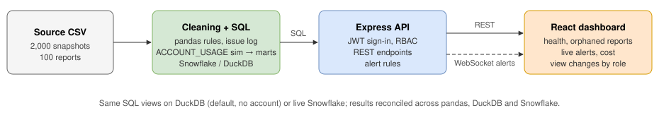
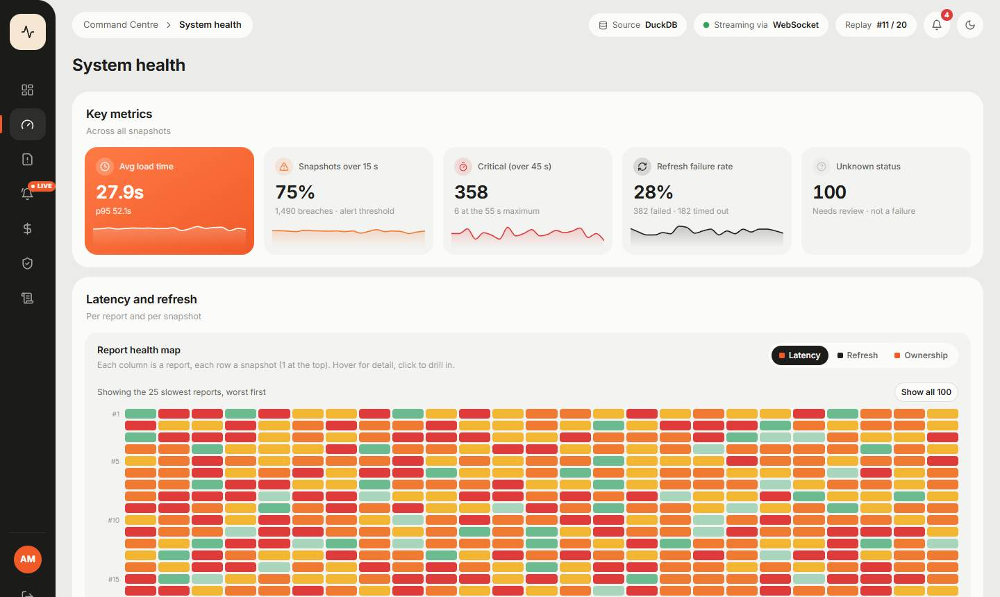
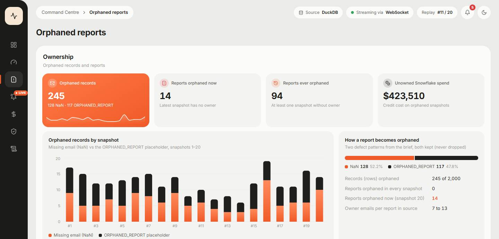
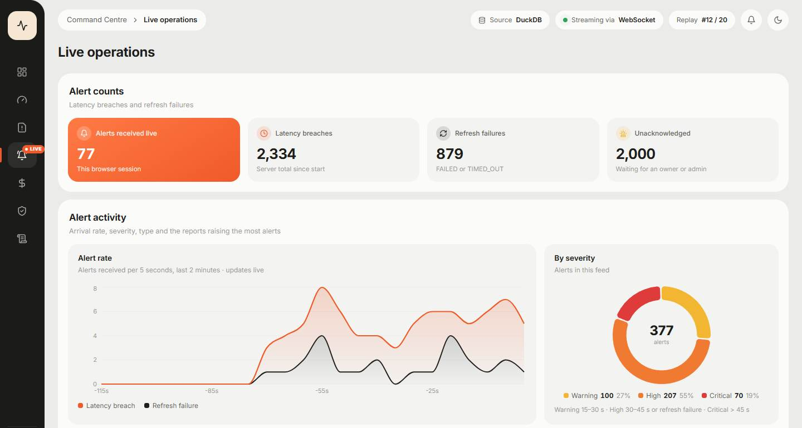
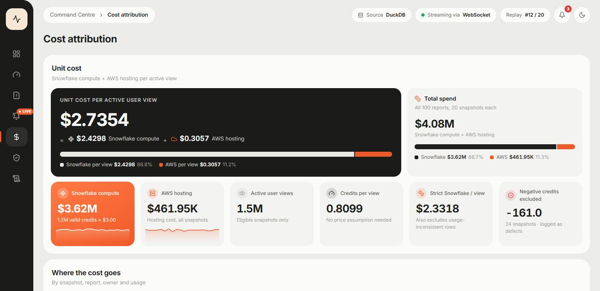
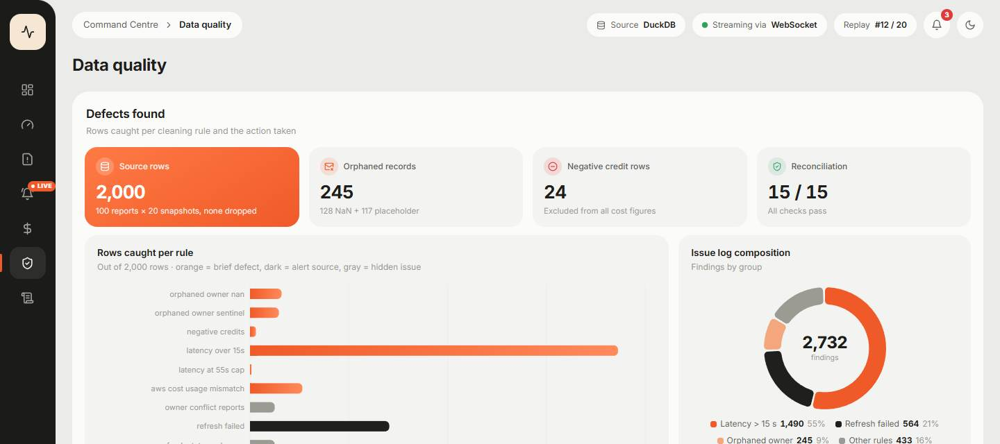

# Pure Insights Command Centre

Case Study 3 (Technical Data & AI Validation – Monetization) by Rudra Solanki.

When the analytics portal moved off Tableau Server, the admins lost sight of report usage, failing refreshes, ownership and Snowflake spend. This project brings that back: a role-based dashboard that monitors report health and orphaned reports, pushes an alert the moment a dashboard is slow or a refresh fails, and attributes Snowflake credits to every report down to a cost per active user view. The four data defects injected into the source file are found and handled in code.

| Brief deliverable | Where |
|---|---|
| 1. Full-stack codebase (React + Node.js) | [`frontend/`](frontend/) and [`backend/`](backend/) |
| 2. REST API & WebSocket specification | [`docs/api_spec.md`](docs/api_spec.md) |
| 3. Snowflake cost allocation SQL suite | [`sql/`](sql/) (start with [`sql/README.md`](sql/README.md)) |
| Defect log, assumptions, reconciliation | [`docs/validation_report.md`](docs/validation_report.md) |

## Run it

Needs Node.js 20 or later. No accounts, no `.env` file and no database setup.

```bash
npm run setup      # installs backend and frontend
npm run dev        # starts the API and the dashboard; open the local address it prints
```

On first start the backend builds its DuckDB database from `sql/duckdb/` (a few seconds). Sign in with any of the demo users; the password for all of them is `demo123`.

| User | Role |
|---|---|
| admin@company.com | Platform Admin |
| finops@company.com | FinOps Analyst |
| user_3@company.com | Report Owner |
| viewer@company.com | Business Viewer |

Tests: `npm test` (57 backend tests). Python cleaning tests: `pip install -r requirements.txt` then `python -m pytest analysis` (16 tests).

**Running on Snowflake instead of DuckDB (optional).** The SQL suite is also deployed on Snowflake (`sql/snowflake/`). To point the app at it, copy `.env.example` to `.env`, fill in the Snowflake account and key path, and set `DATA_SOURCE=snowflake`. Every API endpoint returns identical results on both engines (compared field by field for all four roles).

## Architecture



The CSV is loaded into DuckDB (the default, no account needed) or Snowflake. The same SQL views run on both. The Express backend queries those views, enforces access on every request and replays the snapshots as live telemetry; the React frontend calls the REST API and receives alerts over WebSocket.

## 1. Full-stack application

React frontend and Node.js/Express backend with role-based access control, monitoring system health and orphaned reports.

**Access control.** Four roles, each built from permissions rather than hard-coded role checks. The JWT only says who you are; on every request the server works out what you may do and filters the data before it leaves. If the UI hides a button and someone calls the endpoint anyway, they get a 403 and an audit-log entry.

| Role | Sees | Can do |
|---|---|---|
| Platform Admin | Everything, including raw owner emails and the audit log | Approve ownership claims, acknowledge any alert |
| FinOps Analyst | All health and cost data, emails masked | Read only |
| Report Owner | Only the reports they own (12 for the demo owner) | Claim an orphaned report, acknowledge their alerts |
| Business Viewer | Platform health only | Read only |

**System health.** Key numbers on top, a health map of the worst reports across their 20 snapshots, the load-time distribution, refresh outcomes, and a sortable list that drills into any report.



**Orphaned reports.** 245 of the 2,000 rows have no owner (a missing email or the placeholder `ORPHANED_REPORT`). A report counts as orphaned when its latest snapshot has no owner: 14 reports. Every report also carries 7 to 13 different owner emails in the source, so ownership is never reassigned silently: a Report Owner requests it, an admin approves it, and nobody can approve their own claim.



**Real-time alerts.** The source file is static, so the backend replays it snapshot by snapshot as live telemetry. Every load time over 15 s and every `FAILED` or `TIMED_OUT` refresh raises an alert, pushed over Socket.IO to the people allowed to see it. The brief says alerts fire *whenever*, so nothing is throttled; a test checks that one full replay produces exactly 1,490 latency and 564 refresh alerts. Severity tiers (15–30 s, 30–45 s, over 45 s) help people prioritise.



## 2. REST API & WebSocket specification

Full specification with payloads, errors and rooms: [`docs/api_spec.md`](docs/api_spec.md).

| Endpoints | Permission | Returns |
|---|---|---|
| `GET /api/health/summary`, `/reports`, `/snapshots` | `health:read` | Health per report and snapshot, scoped to the caller |
| `GET /api/reports/:id` | `health:read` | One report; 403 for someone else's |
| `GET /api/orphaned`, `POST /api/orphaned/:id/claims` | `orphaned:read`, `:claim` | Orphaned reports; request ownership |
| `POST /api/orphaned/claims/:id/approve` or `/reject` | `orphaned:approve` | Decide a claim (not your own) |
| `GET /api/cost/summary`, `/reports`, `/showback`, `/waste` | `cost:read:all` / `:own` | Unit cost, credits per report, cost per owner, waste |
| `GET /api/alerts`, `POST /api/alerts/:id/ack` | `alerts:read`, `:ack` | Recent alerts; acknowledge |
| `GET /api/data-quality/summary`, `GET /api/audit` | `dq:read`, `audit:read` | Rule counts and checks; audit trail |

**WebSocket.** The client connects with its token; the server checks it during the handshake and places the connection in rooms based on its permissions (`alerts:all`, `telemetry:all`, `telemetry:masked`, `owner:<email>`). Events (`alert`, `alert:ack`, `telemetry`, `simulator:status`) go only to the right rooms, so a client never receives data it shouldn't. SSE would also work for one-way alerts; Socket.IO was chosen for rooms, handshake authentication and automatic reconnects.

## 3. Snowflake cost allocation SQL suite

The CSV is reshaped into simulated `ACCOUNT_USAGE` logs: `QUERY_ATTRIBUTION_HISTORY` (each query carries its report in `query_tag`) and `WAREHOUSE_METERING_HISTORY` (the warehouse bill). The SQL then runs in layers: raw → account_usage_sim → staging (one flag per defect, nothing deleted) → marts (cost per report, unit cost, showback, orphaned spend, waste) → audit (rule counts, issue log, 15 reconciliation checks). The same suite exists for Snowflake (`sql/snowflake/`) and DuckDB (`sql/duckdb/`).

```sql
-- Unit cost per active user view: a ratio of sums over eligible snapshots
-- (credits not negative, views above zero), never an average of row ratios.
SELECT SUM(IFF(per_view_eligible, credit_cost_usd, 0))
         / NULLIF(SUM(IFF(per_view_eligible, monthly_active_views, 0)), 0) AS credit_cost_per_view_usd
FROM staging.v_snapshot_clean;
```

| Result | Value |
|---|---|
| Valid credits attributed | 1,206,352.48 ($3.62M at an assumed $3 per credit) |
| Unit cost per active user view (Snowflake) | **$2.4298** (0.8099 credits) |
| With AWS hosting added | **$2.7354** ($2.4298 + $0.3057) |



## 4. Defects, validation and assumptions

Details: [`docs/validation_report.md`](docs/validation_report.md).

| Defect (from the brief) | How it was found | Rows | What was done |
|---|---|---:|---|
| Orphaned owner | Email missing or `ORPHANED_REPORT` | 245 | Flagged and kept; drives the orphaned page |
| Negative credits | Credits below zero | 24 | Excluded from cost, never flipped to positive |
| Latency spikes | Load time over 15 s, up to 55 s | 1,490 | Kept as real; each one alerts |
| AWS cost vs active users | AWS cost per view above the Tukey fence ($1.35) | 212 | Flagged; AWS shown as its own line |

Each rule is a named, tested function in pandas (`analysis/clean.py`) and the same rule in SQL; every finding is logged with its row and original value in `data/clean/issues.csv`. Issues the brief doesn't mention were found too: a fourth refresh status (`UNKNOWN`), four snapshots with zero views, 93 rows where concurrent users exceed monthly views, and no date column, so the 20 rows per report are treated as snapshots in file order.



**Checking the numbers.** The SQL runs 15 internal checks (15/15 on both engines); pandas, DuckDB and Snowflake are compared rule by rule and row by row (35/35, see [`analysis/reconciliation.md`](analysis/reconciliation.md)); and every API endpoint was compared on DuckDB against live Snowflake for all four roles (26/26 identical). That comparison caught two real bugs, a truncated p95 in DuckDB and a date format mismatch, both fixed.

**Main assumptions.** 20 snapshots per report in file order; $3.00 per credit; a report is orphaned when its latest snapshot has no owner; every breach alerts, with no cooldown; owner costs are shown as showback rather than chargeback, because ownership in the source is too ambiguous to bill anyone yet.

## Limitations

- Telemetry is a replay of the static CSV, not a live feed.
- Sign-in uses mocked identity-provider groups and demo users, not a real SSO provider.
- Ownership claims, alerts and the audit log are kept in memory and reset when the backend restarts; in production they would be database tables.
- The credit price ($3.00) is an assumption, defined once in `staging.v_config`.
- The backend and the Python cleaning are tested; the React pages were checked in a headless browser for every role but have no automated tests.

## Repository layout

```
backend/      Express API, role-based access, Socket.IO alerts, tests
frontend/     React dashboard
sql/          duckdb/ and snowflake/ suites, results/ (exported outputs)
analysis/     pandas cleaning, tests, cross-engine reconciliation
data/         raw/ (original CSV), clean/ (cleaned data and issue log)
docs/         API spec, validation report, architecture diagram, screenshots
```

`data/raw/case_study_3.csv` is the file provided with the brief, copied unchanged. The brief calls it `Case_Study_3_Pure_Insights_Monitoring.csv`; the file I received had a different name, so I kept the content and gave it a short name.
